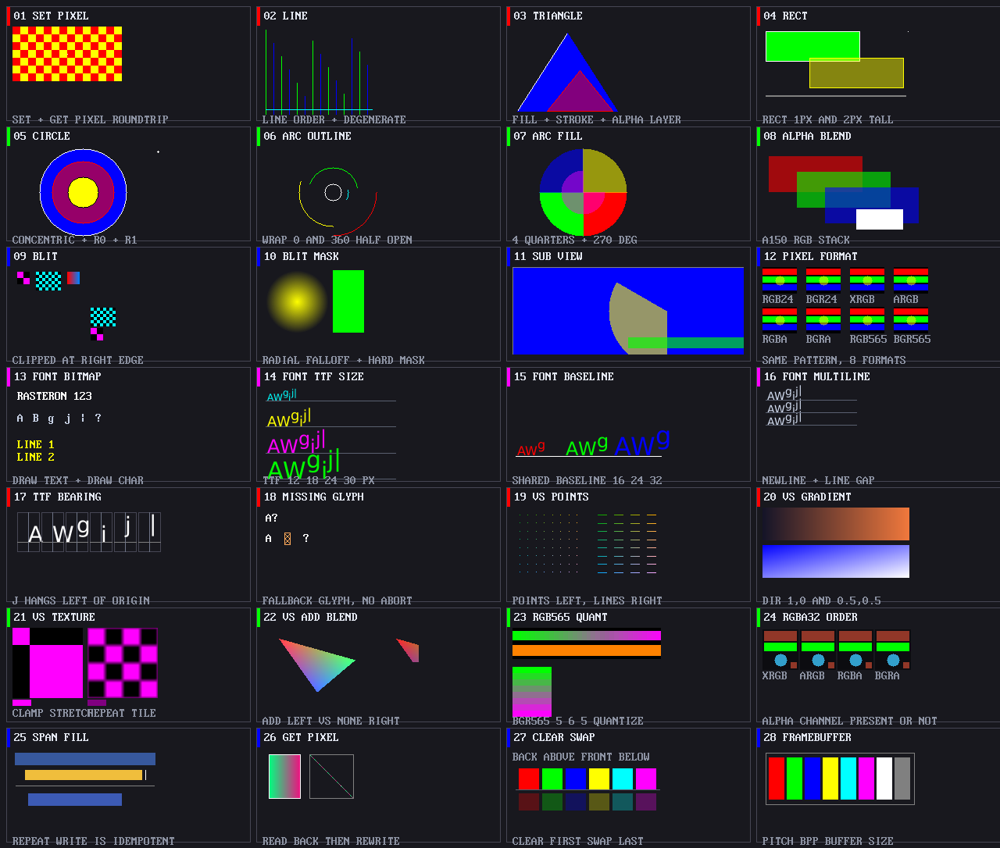

# rasteron

**`no_std`、零依赖、零分配的 2D 软件光栅化库**——直接画进你已有的帧缓冲，不碰 FPU（可选），不碰分配器。

`rasteron` 把像素、线段、矩形、三角形、圆、圆弧、扇形、位图拷贝和文本直接写进一块线性内存。固定功能路径全程整数运算，不依赖 `std`、不需要全局分配器、不引入任何运行时依赖。



> 上图由 `cargo run --example gallery` 生成：28 格编号网格，覆盖固定功能图元、双缓冲与子视口、
> 字体排版、可编程管线与 8 种像素格式。格子标题与说明文字都由库自己的 `draw_text` 绘制。

## 30 秒上手

```rust
use rasteron::color::{Color, PixelFormat};
use rasteron::framebuffer::FramebufferInfo;
use rasteron::{Pixel, Renderer};

let format = PixelFormat::Bgr24;
let info = FramebufferInfo::new(320, 240, 320 * format.bytes_per_pixel(), format);

let mut framebuffer = vec![0u8; info.buffer_size()];   // 缓冲区由你提供
let mut renderer = Renderer::new(info, &mut framebuffer);

renderer.clear(Color::new(20, 24, 32));
renderer.fill_circle(Pixel::new(160, 120), 48, Color::new(40, 160, 240));
renderer.draw_line(
    Pixel::new(0, 0),
    Pixel::new(319, 239),
    &Color::with_alpha(255, 255, 255, 180),
);
```

三步：描述帧缓冲 → 交出切片 → 画。`Renderer` 借用你的缓冲区，绘制就地发生，不做任何分配。

库不分配帧缓冲，但**示例程序需要 `std` 才能把结果写成 BMP**——`vec![]` 只是示例的便利写法。裸机或内核里换成静态数组或从固定地址切出的切片即可。

### 安装

```toml
[dependencies]
rasteron = { path = "../rasteron" }   # 或 git = "<仓库地址>"
```

项目尚未发布到 crates.io，仓库也未配置远端；`git` 方式需替换为实际地址。

## 适合谁

- **写内核 GUI / bootloader 的**：能在 `no_std` 下用，没有依赖包袱，不要求 FPU。
- **自建图形栈的**：需要精确控制帧缓冲布局，且不想被某个框架的抽象绑住。
- **做底层绘图的 Rust 学习者**：全部实现可读，458 个测试护栏，几何与内存契约都写进了文档。

## 不适合谁

- **要 3D、抗锯齿、变换矩阵**——这是纯 2D 光栅化器，不含投影、深度、光照。
- **纹理密集的场景**——纹理采样只有 nearest / bilinear，无 mipmap，缩小会走样。
- **要完整的 Unicode 排版**——文本层有基线 / bearing / 换行，但**不做 kerning、
  连字、双向文字与断行**，这些得在调用方或 `Font` 实现里补。
- **图元数量极多且需抗锯齿**——固定功能图元是硬边整数光栅化，没有 AA。

## 特性

- **图元**：像素、线段、矩形、三角形、圆、圆弧、扇形，描边与填充成对；每种都有整数精确语义。
- **像素格式**：`Rgb24` / `Bgr24` / `Xrgb8888` / `Argb8888` / `Rgba8888` / `Bgra8888` / `Rgb565` / `Bgr565`。
- **混合与拷贝**：Alpha 混合、十六进制颜色解析、`blit` 原始拷贝、`blit_mask` 掩码拷贝。
- **定点角度**：`Angle` 用整圈 `2^32` 圈值 + 波表实现三角函数，加减自动回绕，**不碰浮点**。
- **双缓冲与子视口**：前后台缓冲区都由你提供；子视口让每个 UI 面板拥有独立坐标系，无需全局 scissor。
- **可选可编程管线**：顶点着色器 + varying 重心插值 + 片元着色器 + viewport/scissor + 索引绘制 + 2D 纹理采样。
- **可选 SIMD**：AVX-512 / AVX2 / SSE2 / NEON / RISC-V Vector 上的内存操作优化，未对齐自动回退标量。
- **可选字体**：内置 8×16 点阵 ASCII（零分配），或 TrueType/OpenType 抗锯齿字体
  （`fontdue` 后端）。`draw_char` / `draw_text` 通用，字号、基线、bearing 全部走
  度量接口，排版累加用 26.16 定点，长串不漂移。

## Feature 标志

| Feature | 默认 | 作用 |
|---------|------|------|
| `programmable` | ✅ | 可编程 2D 管线。固定功能路径里**唯一引入 `f32` 的标志**，
  无 FPU 目标请关闭（`font_truetype` 同样会引入浮点，见上）。 |
| `simd` | ✅ | SIMD 内存操作优化。不影响正确性，只影响速度。 |
| `alloc` | ✅ | 允许库内堆分配，提供 `draw_char_owned` / `draw_text_owned` 免 scratch 方法。关闭后库内**绝不分配**。 |
| `font_bitmap` | ✅ | 内置 8×16 点阵字体（ASCII），零分配、不碰浮点。 |
| `font_truetype` | ✅ | TrueType / OpenType 抗锯齿字体。**会引入 `fontdue` 依赖与`alloc`**，且光栅化内部用浮点——内核态目标须关闭。 |

除 `font_truetype` 外全部组合零运行时依赖；它依赖 `fontdue`（`no_std` + `alloc`）。
纯整数渲染：

```bash
cargo build --no-default-features
```

## 几条必须知道的约定

坐标系 **Y 轴向下**，`(0, 0)` 在左上角；角度 `0°` 向右、`90°` 向下。

除此之外，三条硬契约：

| 约定 | 违反后果 |
|------|---------|
| `pitch ≥ width × bytes_per_pixel` | `FramebufferInfo::new` panic |
| 传入切片 `≥ pitch × height` 字节 | `Renderer::new` panic |
| 图元超出可见区 | **不算错误**，静默裁剪 |

缓冲区大小用 `info.buffer_size()` 取准确值（它会计入行填充）。

## 文本

字体接口把**度量**（`layout` / `metrics`，零分配）与**光栅化**（`rasterize`，写调用方
缓冲）分开。**库内默认绝不分配**，光栅化用的 scratch 由调用方提供：

```rust
use rasteron::color::Color;
use rasteron::font::ttf::TtfFont;   // 需 font_truetype
use rasteron::{Pixel, Renderer};

let font = TtfFont::new(&ttf_bytes);
let mut scratch = [0u8; 64 * 64];   // 单字位图上限，调用方出

// 一行字：自动对齐基线、推进画笔、遇 \n 换行
renderer.draw_text(Pixel::new(8, 8), "Hello", 24.0, Color::WHITE, &font, &mut scratch);

// 单字：origin 是**基线**原点，不是左上角
renderer.draw_char(Pixel::new(8, 32), 'A', 24.0, Color::WHITE, Some(&font), &mut scratch);

// 开了 alloc feature 时可以省掉 scratch，库内按字号精确分配：
renderer.draw_text_owned(Pixel::new(8, 8), "Hello", 24.0, Color::WHITE, &font);
```

三条要点：

- **基线坐标系**：`origin.y` 是基线所在行，字形按 `bearing` 相对它定位。带悬挂部的
  字（斜体、`f`、`j`）`bearing_x` 为负，`draw_glyph` 会同时裁掉源掩码的左边界。
- **字号是 `f32`**：`font_truetype` 的光栅化本就以浮点累加（fontdue 内部），故
  接口不再假装能定点。**内核态目标应关闭 `font_truetype`**；`font_bitmap` 路径
  不产生任何浮点运算。
- **排版累加走定点**：画笔由 `PenX`（26.16 定点）持有，每步量化到 1/65536 px。
  1/64 px 的网格表示不了常见的比例 advance（`1+1/128`），一行 1600 字会漂移
  12.5 px；1/65536 下常见 advance 全部精确，误差恒为 0。

`Font` 是可自己实现的 trait：`layout` 与 `metrics` 不得分配，`rasterize` 把掩码写进
你给的 `&mut [u8]`（容量不足即 panic——按 `layout.mask_len()` 准备即可）。

签名**不按 feature 分裂**：`draw_char` / `draw_text` 在任何构建下都收 scratch，
调用点不会因 feature 变化而改代码；`*_owned` 变体只在开启 `alloc` 时存在。

## 示例

四个示例都会在仓库根目录生成 BMP（`*.bmp` 已被 `.gitignore` 排除）：

```bash
cargo run --example gallery       # 全部图元的人工比对基准图
cargo run --example basic         # 双缓冲场景：渐变天空、房子、blit、掩码烟雾
cargo run --example subviewport   # 三个面板，各自坐标系，越界内容不泄漏
cargo run --example programmable  # 可编程管线画点阵
```

`gallery` 是改动图元后的回归基准——每格有编号，出错时能一眼定位到具体图元。


`subviewport` 演示的核心思路：**裁剪不是渲染器上的状态，而是「用缓冲区的一个切片构造一个受限 `Renderer`」**。面板外泄漏像素数会打印在 stdout（正常为 0）。

## 进一步阅读

- **`docs/design.md`** — 架构决策、内存契约、错误分层、feature 门控规则等实现细节
- **源码文档** — 每个公开 API 都有带可运行示例的 `///` 文档，`cargo doc --open` 即可
- **`examples/`** — 四个可运行的完整程序

## 开发

```bash
cargo test                                          # 458 项：lib 396 + 集成 22 + doctest 41
cargo test --lib --no-default-features              # 216 项，验证 feature 门控
cargo check --all-features
cargo bench                                         # 16 组 criterion 基准，耗时较长
```

`--no-default-features` 是验证「关闭 `programmable` / `font_truetype` 后不碰浮点」的
唯一门径，任何改动后都应跑一遍。

MSRV 为 Rust 1.85+（下限由 `edition = "2024"` 决定）。

## 许可证

**尚未声明许可证**，仓库也未配置远端。发布或作为依赖引入前，需先补 `LICENSE` 文件与 `Cargo.toml` 的 `license` 字段。
